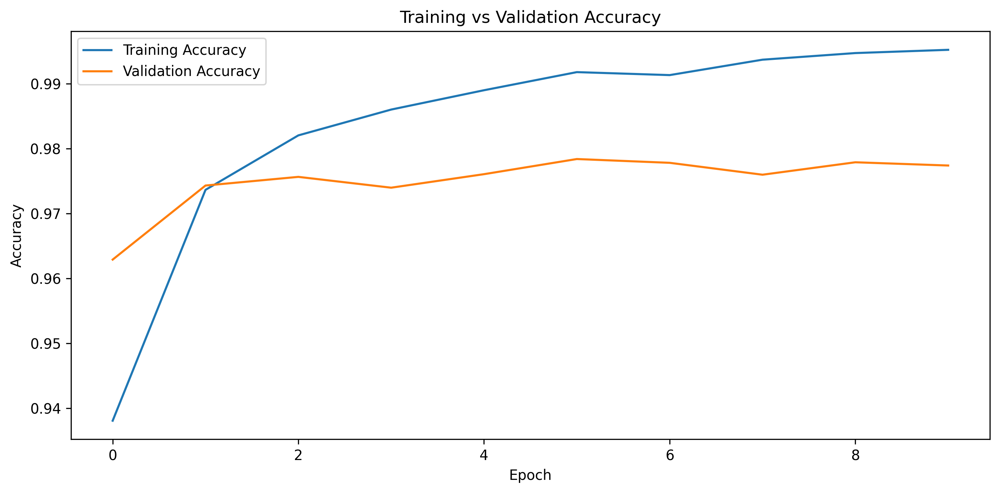
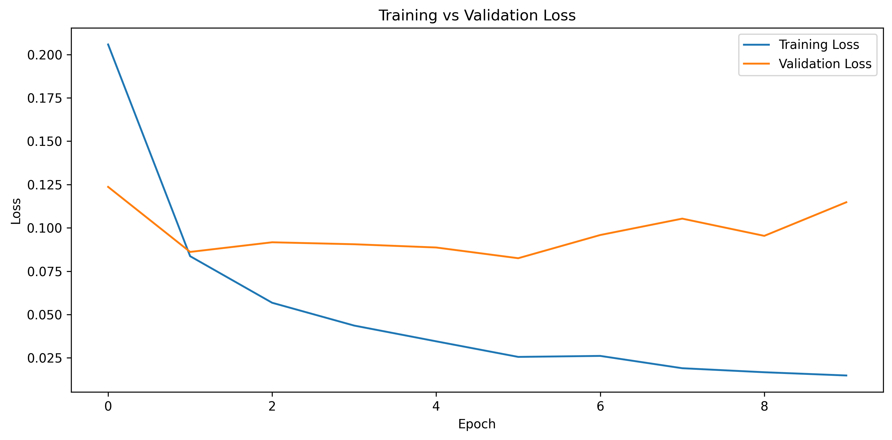

# MNIST Digit Classification

<p align="center">
  <strong>A neural network built with TensorFlow and Keras to classify handwritten digits from 0 to 9.</strong>
</p>

<p align="center">
  
  
  
  
</p>

## Overview

This project implements a **multiclass image classification model** that recognizes handwritten digits using the MNIST dataset. It uses a fully connected feedforward neural network built with TensorFlow and Keras.

The workflow includes automatic dataset loading, image preprocessing, one-hot encoding, neural network construction, model training, evaluation on a separate test set, and visualization of training performance.

The model achieved **98.09% test accuracy** after 10 epochs.

## Results

| Metric | Result |
|---|---:|
| Test Accuracy | **98.09%** |
| Test Loss | 0.0819 |
| Final Training Accuracy | 99.52% |
| Final Training Loss | 0.0148 |
| Total Trainable Parameters | 694,950 |
| Training Epochs | 10 |

*Results are from a completed training run. Minor variations may occur between runs.*

## Training Visualizations

### Training vs. Validation Accuracy

This graph tracks how accurately the model classifies training and validation images over successive epochs.



### Training vs. Validation Loss

This graph shows how the categorical cross-entropy loss changes during training. The difference between training and validation loss can help identify potential overfitting.



## Dataset

The project uses the **MNIST handwritten digit dataset**, which contains grayscale images of digits from 0 to 9.

| Property | Details |
|---|---|
| Training images | 60,000 |
| Test images | 10,000 |
| Image dimensions | 28 × 28 pixels |
| Input features per image | 784 |
| Number of classes | 10 |
| Pixel value range before preprocessing | 0–255 |
| Pixel value range after preprocessing | 0–1 |

The dataset is loaded automatically through `tensorflow.keras.datasets.mnist`. On the first run, an internet connection is required to download it.

### Preprocessing

- **Flattening:** Converts each 28 × 28 image into a 784-element feature vector.
- **Normalization:** Converts pixel values to floating-point numbers between 0 and 1 by dividing by 255.
- **One-hot encoding:** Represents each digit label as a vector of 10 values, with the correct class set to 1.
- **Validation split:** Reserves 20% of the original training data for validation during training.
- **Test set:** Keeps the official test dataset separate for final model evaluation.

## Model Architecture

The model is a fully connected neural network with two hidden layers.

| Layer | Output Shape | Parameters | Activation |
|---|---|---:|---|
| Input | 784 | 0 | — |
| Dense — Hidden Layer 1 | 784 | 615,440 | ReLU |
| Dense — Hidden Layer 2 | 100 | 78,500 | ReLU |
| Dense — Output Layer | 10 | 1,010 | Softmax |
| **Total** | | **694,950** | |

### Training Configuration

| Parameter | Value |
|---|---|
| Optimizer | Adam |
| Learning rate | 0.001 |
| Loss function | Categorical Cross-Entropy |
| Evaluation metric | Accuracy |
| Batch size | 32 |
| Epochs | 10 |
| Random seed | 42 |

The hidden layers use **ReLU** to learn nonlinear patterns in the images. The output layer uses **Softmax** to produce a probability distribution across the 10 digit classes.

## Project Structure

```text
MNIST-Digit-Classification/
├── main.py
├── requirements.txt
├── .gitignore
├── README.md
├── outputs/
│   ├── training_accuracy.png
│   └── training_loss.png
└── src/
    ├── __init__.py
    ├── config.py
    ├── data_loader.py
    ├── preprocessing.py
    ├── model.py
    ├── trainer.py
    ├── evaluator.py
    └── visualizer.py
```

### Code Organization

| File | Responsibility |
|---|---|
| `main.py` | Coordinates the complete workflow |
| `config.py` | Stores model and training configuration |
| `data_loader.py` | Loads the MNIST dataset |
| `preprocessing.py` | Flattens, normalizes, and encodes the data |
| `model.py` | Builds the neural network architecture |
| `trainer.py` | Compiles and trains the model |
| `evaluator.py` | Evaluates performance on the test dataset |
| `visualizer.py` | Generates and saves training graphs |

## Installation and Usage

### 1. Clone the repository

```bash
git clone https://github.com/ayushman652/mnist-digit-classification.git
cd mnist-digit-classification
```

### 2. Create and activate a virtual environment

**Windows PowerShell:**

```powershell
python -m venv .venv
.\.venv\Scripts\Activate.ps1
```

**macOS / Linux:**

```bash
python3 -m venv .venv
source .venv/bin/activate
```

### 3. Install dependencies

```bash
python -m pip install -r requirements.txt
```

### 4. Run the project

```bash
python main.py
```

The program loads the dataset, preprocesses the images and labels, builds the model, trains it, evaluates it on the test set, and saves the training visualizations in the `outputs/` directory.

## Key Learnings

- Understanding dense neural networks for multiclass classification.
- Applying image flattening and pixel normalization.
- Converting categorical labels into one-hot encoded vectors.
- Understanding ReLU, Softmax, and categorical cross-entropy.
- Training neural networks using mini-batches and the Adam optimizer.
- Monitoring training and validation metrics to assess model generalization.
- Evaluating the final model using an independent test dataset.

## Future Improvements

- Add a confusion matrix and per-class precision, recall, and F1-score.
- Visualize sample predictions and misclassified digits.
- Experiment with network architectures and regularization techniques.
- Compare the fully connected network with a convolutional neural network (CNN).

## Author

**Ayushman Singh**

Computer Science and Engineering Student | Machine Learning & Deep Learning

- GitHub: [@ayushman652](https://github.com/ayushman652)
- LinkedIn: [Connect with me](https://www.linkedin.com/)

---

<p align="center">
  <sub>Built with Python, TensorFlow, and Keras.</sub>
</p>